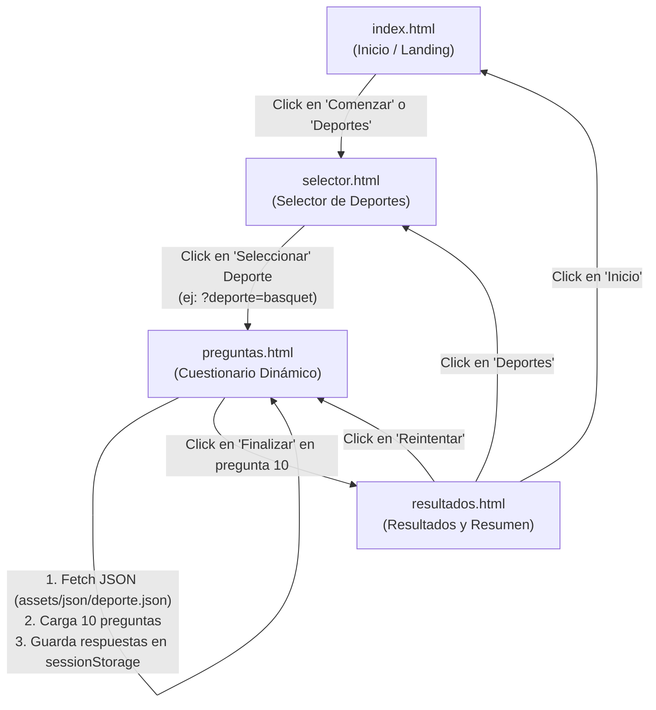

# Documento de Arquitectura y Dinamización: CHAMPASPORT
**Proyecto BTH - Técnico Medio en Sistemas Informáticos**
**Framework obligatorio:** Materialize CSS

---

## 1. Introducción y Objetivo

El presente documento técnico establece la arquitectura, diseño de flujo de datos y código fuente necesario para transformar las páginas web estáticas de **CHAMPASPORT** en una aplicación web interactiva y dinámica. 

La aplicación permite a los usuarios:
1. **`index.html` (Landing Page):** Conocer la plataforma y navegar hacia el selector de disciplinas.
2. **`selector.html` (Selector de Deportes):** Escoger qué cuestionario deportivo desean realizar.
3. **`preguntas.html` (Evaluador Dinámico):** Cargar aleatoria y dinámicamente las preguntas desde los archivos JSON correspondientes, permitiendo responder con retroalimentación visual, navegación hacia adelante/atrás y barra de progreso.
4. **`resultados.html` (Ficha de Rendimiento):** Visualizar el puntaje obtenido, porcentaje de aciertos, desglose estadístico y revisión de respuestas con sus respectivas explicaciones.

> **Regla de Oro del Proyecto:** Todo el diseño, componentes visuales, grillas, modales, alertas y botones deben utilizar exclusivamente las clases y componentes nativos de **Materialize CSS**.

---

## 2. Mapa de Navegación y Flujo de Datos



---

## 3. Estructura de los Archivos JSON

Los archivos se encuentran en `assets/json/`:
* `ajedrez.json`
* `basquet.json`
* `futsal.json`
* `tenis.json`
* `voley.json`

Cada archivo contiene un arreglo de 40 objetos con la siguiente estructura estandarizada:

```json
[
  {
    "id": 1,
    "pregunta": "¿A quién deben notificar inmediatamente los participantes si detectan un error corregible en el marcador o reloj?",
    "opciones": {
      "a": "Al comisario del partido",
      "b": "A los árbitros",
      "c": "Al anotador únicamente",
      "d": "Al delegado técnico"
    },
    "respuesta_correcta": "b",
    "explicacion": "Según el Art. 1.2, todos los participantes deben notificar inmediatamente a los árbitros cualquier irregularidad identificada para que el error pueda ser corregido."
  }
]
```

---

## 4. Estrategia de Implementación Técnica

### 4.1. Comunicación entre Páginas sin Servidor Backend
Para comunicar las vistas de manera fluida y compatible con cualquier navegador local:
1. **De `selector.html` a `preguntas.html`:** Se usa el parámetro de consulta en la URL:
   `preguntas.html?deporte=basquet`
2. **De `preguntas.html` a `resultados.html`:** Se utiliza **`sessionStorage`** bajo la clave `'champasport_resultado'`. Esto permite transferir el deporte seleccionado, las preguntas evaluadas, las respuestas del usuario, la cantidad de aciertos y el tiempo transcurrido sin sobrecargar la URL.

### 4.2. Estructura Modular de Archivos JS
Aprovechando las carpetas que ya existen en el proyecto:
* `assets/js/pages/selector.js`: Controla la selección de disciplinas y validaciones.
* `assets/js/pages/questions.js`: Carga el JSON, baraja preguntas, gestiona el estado (pregunta actual, selección de opciones, barra de progreso) y redirige al finalizar.
* `assets/js/pages/results.js`: Lee los resultados de `sessionStorage`, calcula porcentajes, actualiza la tabla y genera la revisión detallada con componentes Materialize.

---

## 5. Implementación Código por Código

### 5.1. `assets/js/pages/selector.js`
Este script se encarga de asociar cada botón "Seleccionar" con su deporte correspondiente y navegar a `preguntas.html?deporte=<nombre>`.

```javascript
/**
 * assets/js/pages/selector.js
 * CHAMPASPORT - Controlador del selector de deportes
 */
document.addEventListener('DOMContentLoaded', () => {
    // Inicializar componentes Materialize
    M.Sidenav.init(document.querySelectorAll('.sidenav'));

    // Mapeo de botones a sus archivos JSON
    const deportesDisponibles = {
        'basquet': { nombre: 'Básquet', json: 'basquet.json', activo: true },
        'futsal': { nombre: 'Futsal', json: 'futsal.json', activo: true },
        'tenis': { nombre: 'Tenis', json: 'tenis.json', activo: true },
        'voley': { nombre: 'Vóley', json: 'voley.json', activo: true },
        'ajedrez': { nombre: 'Ajedrez', json: 'ajedrez.json', activo: true },
        'local': { nombre: 'Deporte Local', json: null, activo: false }
    };

    const botones = document.querySelectorAll('.btn-seleccionar');

    botones.forEach((btn) => {
        btn.addEventListener('click', (e) => {
            e.preventDefault();
            const card = btn.closest('.card');
            const titulo = card.querySelector('.titulo-deporte').textContent.trim().toLowerCase();
            
            let claveDeporte = null;
            if (titulo.includes('básquet') || titulo.includes('basquet')) claveDeporte = 'basquet';
            else if (titulo.includes('futsal') || titulo.includes('futbol') || titulo.includes('fútbol')) claveDeporte = 'futsal';
            else if (titulo.includes('tenis')) claveDeporte = 'tenis';
            else if (titulo.includes('voley') || titulo.includes('vóley')) claveDeporte = 'voley';
            else if (titulo.includes('ajedrez')) claveDeporte = 'ajedrez';
            else if (titulo.includes('local')) claveDeporte = 'local';

            if (!claveDeporte || !deportesDisponibles[claveDeporte].activo) {
                M.toast({
                    html: '<i class="material-icons left">info</i>Este cuestionario estará disponible próximamente',
                    classes: 'rounded amber darken-3'
                });
                return;
            }

            // Redirigir enviando el deporte como parámetro GET
            window.location.href = `preguntas.html?deporte=${claveDeporte}`;
        });
    });
});
```

---

### 5.2. `assets/js/pages/questions.js`
Este script convierte `preguntas.html` en un motor de evaluación dinámico con Materialize.

```javascript
/**
 * assets/js/pages/questions.js
 * CHAMPASPORT - Motor Dinámico de Cuestionarios
 */
document.addEventListener('DOMContentLoaded', async () => {
    // Inicializar sidenav
    M.Sidenav.init(document.querySelectorAll('.sidenav'));

    // 1. Obtener el deporte desde la URL (?deporte=basquet)
    const urlParams = new URLSearchParams(window.location.search);
    const deporte = urlParams.get('deporte') || 'basquet';

    // Metadatos por deporte (imágenes y títulos)
    const infoDeportes = {
        'basquet': { nombre: 'BÁSQUETBOL', img: 'assets/img/basquet.png' },
        'futsal': { nombre: 'FUTSAL', img: 'assets/img/futbol.png' },
        'tenis': { nombre: 'TENIS', img: 'assets/img/tenis.png' },
        'voley': { nombre: 'VÓLEY', img: 'assets/img/voley.png' },
        'ajedrez': { nombre: 'AJEDREZ', img: 'assets/img/ajedrez.png' }
    };

    const configActual = infoDeportes[deporte] || { nombre: deporte.toUpperCase(), img: 'assets/img/principal.png' };

    // Elementos del DOM
    const tituloPregunta = document.getElementById('texto-pregunta');
    const imagenPregunta = document.getElementById('imagen-pregunta');
    const contenedorOpciones = document.getElementById('contenedor-opciones');
    const textoProgreso = document.getElementById('texto-progreso');
    const barraProgreso = document.getElementById('barra-progreso');
    const btnAnterior = document.getElementById('btn-anterior');
    const btnSiguiente = document.getElementById('btn-siguiente');

    if (imagenPregunta) imagenPregunta.src = configActual.img;

    let preguntas = [];
    let indiceActual = 0;
    const respuestasUsuario = {}; // { 0: 'a', 1: 'c', ... }
    const TOTAL_EVALUAR = 10; // 10 preguntas por examen

    // 2. Cargar archivo JSON
    try {
        const respuesta = await fetch(`assets/json/${deporte}.json`);
        if (!respuesta.ok) throw new Error(`No se pudo cargar el archivo ${deporte}.json`);
        const todasLasPreguntas = await respuesta.json();

        // Barajar aleatoriamente y seleccionar 10 preguntas
        preguntas = todasLasPreguntas.sort(() => 0.5 - Math.random()).slice(0, TOTAL_EVALUAR);
    } catch (error) {
        console.error(error);
        M.toast({
            html: '<i class="material-icons left">error</i>Error al cargar las preguntas del deporte.',
            classes: 'rounded red accent-4'
        });
        setTimeout(() => window.location.href = 'selector.html', 2000);
        return;
    }

    // 3. Función para renderizar la pregunta actual
    function mostrarPregunta(index) {
        const p = preguntas[index];
        if (!p) return;

        // Actualizar texto de la pregunta
        if (tituloPregunta) {
            tituloPregunta.textContent = `${index + 1}. ${p.pregunta}`;
        }

        // Actualizar barra de progreso
        const porcentaje = Math.round(((index + 1) / TOTAL_EVALUAR) * 100);
        if (barraProgreso) barraProgreso.style.width = `${porcentaje}%`;
        if (textoProgreso) {
            textoProgreso.innerHTML = `
                <i class="material-icons left red-text text-accent-4" style="font-size: 1.2rem; margin-right: 6px;">trending_up</i>
                Progreso de examen (${porcentaje}%) - Pregunta ${index + 1} de ${TOTAL_EVALUAR}
            `;
        }

        // Renderizar opciones A, B, C, D
        const letras = ['a', 'b', 'c', 'd'];
        const seleccionPrevia = respuestasUsuario[index];

        let htmlOpciones = '<div class="row" style="margin-bottom: 0;">';
        letras.forEach((letra, idx) => {
            const textoOpcion = p.opciones[letra];
            const estaSeleccionada = seleccionPrevia === letra;

            // Clases de Materialize para respuesta activa
            const colorTarjeta = estaSeleccionada ? 'teal darken-1 z-depth-3' : 'blue darken-2 z-depth-2';
            const colorBotonLetra = estaSeleccionada ? 'amber darken-2' : 'grey darken-4';

            // Cerrar fila cada 2 opciones para mantener la grilla s12 m6
            if (idx === 2) {
                htmlOpciones += '</div><div class="row">';
            }

            htmlOpciones += `
                <div class="col s12 m6 tarjeta-opcion" data-opcion="${letra}" style="margin-bottom: 15px; cursor: pointer;">
                    <div style="display: flex; align-items: center;">
                        <a class="btn-floating btn-large waves-effect waves-light ${colorBotonLetra} center-align bold"
                            style="pointer-events: none; font-weight: 800; flex-shrink: 0; margin-right: 15px;">
                            ${letra.toUpperCase()}
                        </a>
                        <div class="card ${colorTarjeta} hoverable"
                            style="border-radius: 15px; overflow: hidden; width: 100%; margin: 0; transition: transform 0.2s ease;">
                            <div class="card-content white-text" style="padding: 16px 20px;">
                                <span class="card-title bold" style="font-size: 1.15rem; font-weight: 600; margin: 0;">
                                    ${textoOpcion}
                                </span>
                            </div>
                        </div>
                    </div>
                </div>
            `;
        });
        htmlOpciones += '</div>';

        contenedorOpciones.innerHTML = htmlOpciones;

        // Agregar listeners a las opciones
        document.querySelectorAll('.tarjeta-opcion').forEach((opcionCard) => {
            opcionCard.addEventListener('click', () => {
                const opcionElegida = opcionCard.getAttribute('data-opcion');
                respuestasUsuario[index] = opcionElegida;
                mostrarPregunta(index); // Re-renderizar para marcar visualmente
            });
        });

        // Configuración de botones Anterior / Siguiente
        if (btnAnterior) {
            btnAnterior.style.visibility = index === 0 ? 'hidden' : 'visible';
        }

        if (btnSiguiente) {
            if (index === TOTAL_EVALUAR - 1) {
                btnSiguiente.innerHTML = 'Finalizar <i class="material-icons right">done_all</i>';
                btnSiguiente.className = 'waves-effect waves-light btn-large green darken-1 hoverable';
            } else {
                btnSiguiente.innerHTML = 'Siguiente <i class="material-icons right">arrow_forward</i>';
                btnSiguiente.className = 'waves-effect waves-light btn-large red accent-4 hoverable';
            }
        }
    }

    // 4. Eventos de botones
    if (btnAnterior) {
        btnAnterior.addEventListener('click', (e) => {
            e.preventDefault();
            if (indiceActual > 0) {
                indiceActual--;
                mostrarPregunta(indiceActual);
            }
        });
    }

    if (btnSiguiente) {
        btnSiguiente.addEventListener('click', (e) => {
            e.preventDefault();

            // Validar que se haya seleccionado una opción
            if (!respuestasUsuario[indiceActual]) {
                M.toast({
                    html: '<i class="material-icons left">warning</i>Selecciona una respuesta para continuar',
                    classes: 'rounded amber darken-3'
                });
                return;
            }

            if (indiceActual < TOTAL_EVALUAR - 1) {
                indiceActual++;
                mostrarPregunta(indiceActual);
            } else {
                finalizarEvaluacion();
            }
        });
    }

    // 5. Cálculo y redirección a resultados
    function finalizarEvaluacion() {
        let correctas = 0;
        preguntas.forEach((p, idx) => {
            if (respuestasUsuario[idx] === p.respuesta_correcta) {
                correctas++;
            }
        });

        const resultadoData = {
            deporte: deporte,
            nombreDeporte: configActual.nombre,
            totalPreguntas: TOTAL_EVALUAR,
            correctas: correctas,
            incorrectas: TOTAL_EVALUAR - correctas,
            porcentaje: Math.round((correctas / TOTAL_EVALUAR) * 100),
            preguntas: preguntas,
            respuestasUsuario: respuestasUsuario
        };

        // Guardar en sessionStorage para que resultados.html lo consuma
        sessionStorage.setItem('champasport_resultado', JSON.stringify(resultadoData));
        window.location.href = 'resultados.html';
    }

    // Inicializar primera pregunta
    mostrarPregunta(0);
});
```

---

### 5.3. `assets/js/pages/results.js`
Este script toma los datos generados por la evaluación y rellena `resultados.html` con estadísticas, mensajes de rendimiento y revisión completa usando Materialize CSS.

```javascript
/**
 * assets/js/pages/results.js
 * CHAMPASPORT - Controlador de la Vista de Resultados
 */
document.addEventListener('DOMContentLoaded', () => {
    // Inicializar componentes Materialize
    M.Sidenav.init(document.querySelectorAll('.sidenav'));

    // 1. Recuperar los datos desde sessionStorage
    const dataString = sessionStorage.getItem('champasport_resultado');

    if (!dataString) {
        M.toast({
            html: '<i class="material-icons left">info</i>No se encontraron resultados recientes.',
            classes: 'rounded red accent-4'
        });
        setTimeout(() => window.location.href = 'selector.html', 1500);
        return;
    }

    const res = JSON.parse(dataString);

    // 2. Elementos del DOM a actualizar
    const puntajeTexto = document.getElementById('puntaje-texto');
    const barraProgreso = document.getElementById('puntaje-barra');
    const tarjetaMensaje = document.getElementById('tarjeta-mensaje');
    const tituloMensaje = document.getElementById('titulo-mensaje');
    const parrafoMensaje = document.getElementById('parrafo-mensaje');
    const iconoMensaje = document.getElementById('icono-mensaje');
    const correctasTexto = document.getElementById('res-correctas');
    const incorrectasTexto = document.getElementById('res-incorrectas');
    const totalPuntajeTabla = document.getElementById('res-total-tabla');
    const btnReintentar = document.getElementById('btn-reintentar');

    // 3. Inyectar datos numéricos
    if (puntajeTexto) puntajeTexto.textContent = `${res.correctas} / ${res.totalPreguntas}`;
    if (barraProgreso) barraProgreso.style.width = `${res.porcentaje}%`;
    if (correctasTexto) correctasTexto.textContent = res.correctas;
    if (incorrectasTexto) incorrectasTexto.textContent = res.incorrectas;
    if (totalPuntajeTabla) totalPuntajeTabla.textContent = `${res.correctas} / ${res.totalPreguntas} (${res.porcentaje}%)`;

    // 4. Mensaje según rendimiento con colores Materialize
    if (res.porcentaje >= 80) {
        if (tarjetaMensaje) tarjetaMensaje.className = 'card green darken-2 z-depth-2';
        if (iconoMensaje) iconoMensaje.textContent = 'emoji_events';
        if (tituloMensaje) tituloMensaje.textContent = '¡Excelente rendimiento!';
        if (parrafoMensaje) parrafoMensaje.textContent = 'Has demostrado un dominio sobresaliente del reglamento deportivo.';
    } else if (res.porcentaje >= 50) {
        if (tarjetaMensaje) tarjetaMensaje.className = 'card blue darken-2 z-depth-2';
        if (iconoMensaje) iconoMensaje.textContent = 'thumb_up';
        if (tituloMensaje) tituloMensaje.textContent = '¡Buen trabajo!';
        if (parrafoMensaje) parrafoMensaje.textContent = 'Aprobaste el cuestionario, pero aún puedes perfeccionar algunos detalles.';
    } else {
        if (tarjetaMensaje) tarjetaMensaje.className = 'card red accent-4 z-depth-2';
        if (iconoMensaje) iconoMensaje.textContent = 'school';
        if (tituloMensaje) tituloMensaje.textContent = '¡Sigue practicando!';
        if (parrafoMensaje) parrafoMensaje.textContent = 'Repasa las reglas oficiales del deporte e inténtalo de nuevo.';
    }

    // 5. Configurar botón Reintentar
    if (btnReintentar) {
        btnReintentar.href = `preguntas.html?deporte=${res.deporte}`;
    }

    // 6. Generar Sección de Revisión de Preguntas (Collapsible de Materialize)
    const contenedorRevision = document.getElementById('contenedor-revision');
    if (contenedorRevision && res.preguntas) {
        let htmlCollapsible = `
            <div class="card z-depth-2" style="border-radius: 20px; overflow: hidden; margin-top: 25px;">
                <div class="card-content">
                    <span class="card-title red-text text-accent-4 bold" style="font-weight: 700;">
                        <i class="material-icons left">checklist</i>Revisión Detallada de Preguntas
                    </span>
                    <ul class="collapsible popout" style="margin-top: 15px;">
        `;

        res.preguntas.forEach((p, idx) => {
            const respDada = res.respuestasUsuario[idx];
            const esCorrecta = respDada === p.respuesta_correcta;
            const icono = esCorrecta ? 'check_circle' : 'cancel';
            const colorIcono = esCorrecta ? 'green-text' : 'red-text';

            htmlCollapsible += `
                <li>
                    <div class="collapsible-header" style="display: flex; align-items: center; justify-content: space-between;">
                        <span style="font-weight: 600;">
                            <i class="material-icons ${colorIcono}">${icono}</i>
                            Pregunta ${idx + 1}: ${p.pregunta.substring(0, 60)}...
                        </span>
                        <span class="badge ${esCorrecta ? 'green' : 'red'} white-text" style="border-radius: 4px;">
                            ${esCorrecta ? '+1 Pts' : '0 Pts'}
                        </span>
                    </div>
                    <div class="collapsible-body grey lighten-4">
                        <p><strong>Pregunta:</strong> ${p.pregunta}</p>
                        <p><strong>Tu respuesta:</strong> <span class="${esCorrecta ? 'green-text bold' : 'red-text bold'}">(${respDada ? respDada.toUpperCase() : 'Ninguna'}) ${respDada ? p.opciones[respDada] : 'Sin responder'}</span></p>
                        ${!esCorrecta ? `<p><strong>Respuesta correcta:</strong> <span class="green-text text-darken-2 bold">(${p.respuesta_correcta.toUpperCase()}) ${p.opciones[p.respuesta_correcta]}</span></p>` : ''}
                        <div class="card-panel white" style="border-left: 4px solid #d50000; padding: 10px 15px; margin-top: 10px;">
                            <span class="grey-text text-darken-3"><strong>Fundamentación reglamentaria:</strong> ${p.explicacion}</span>
                        </div>
                    </div>
                </li>
            `;
        });

        htmlCollapsible += `
                    </ul>
                </div>
            </div>
        `;
        contenedorRevision.innerHTML = htmlCollapsible;

        // Inicializar el Collapsible de Materialize
        M.Collapsible.init(document.querySelectorAll('.collapsible'));
    }
});
```

---

## 6. IDs y Ajustes en las Páginas HTML

Para que los scripts encuentren dónde inyectar el contenido dinámico, se agregan `id="..."` específicos en los elementos clave respetando el 100% de los estilos y estructura actual.

### 6.1. Ajustes en `selector.html`
Al final del documento, antes de `</body>`, se vincula el script:
```html
<script type="text/javascript" src="assets/js/materialize.js"></script>
<script type="text/javascript" src="assets/js/pages/selector.js"></script>
```

### 6.2. Ajustes en `preguntas.html`
En el bloque de la tarjeta principal y opciones:
1. En la imagen: `id="imagen-pregunta"`
2. En el título de la pregunta: `id="texto-pregunta"`
3. En el bloque de las opciones: reemplazar las tarjetas estáticas fijas por el contenedor contenedor dinámico `<div id="contenedor-opciones"></div>`.
4. En la barra de progreso: 
   * Texto: `id="texto-progreso"`
   * Barra interior: `id="barra-progreso"`
5. En los botones:
   * Botón Anterior: `id="btn-anterior"`
   * Botón Siguiente: `id="btn-siguiente"`
6. Al final antes de `</body>`:
```html
<script type="text/javascript" src="assets/js/materialize.js"></script>
<script type="text/javascript" src="assets/js/pages/questions.js"></script>
```

### 6.3. Ajustes en `resultados.html`
1. Puntaje grande: `id="puntaje-texto"`
2. Barra de progreso de la calificación: `id="puntaje-barra"`
3. Tarjeta de felicitación: `id="tarjeta-mensaje"`
   * Icono: `id="icono-mensaje"`
   * Título: `id="titulo-mensaje"`
   * Párrafo: `id="parrafo-mensaje"`
4. Tabla de estadísticas:
   * Respuestas correctas: `id="res-correctas"`
   * Respuestas incorrectas: `id="res-incorrectas"`
   * Puntuación total: `id="res-total-tabla"`
5. Botón de reintento: `id="btn-reintentar"`
6. Debajo de la grilla de resultados: `<div id="contenedor-revision"></div>` para la revisión interactiva.
7. Al final antes de `</body>`:
```html
<script type="text/javascript" src="assets/js/materialize.js"></script>
<script type="text/javascript" src="assets/js/pages/results.js"></script>
```

---

## 7. Ventajas Pedagógicas y Técnicas para la Defensa BTH

| Característica | Beneficio Técnico | Impacto en la Evaluación BTH |
| :--- | :--- | :--- |
| **Arquitectura Desacoplada** | Los datos (`.json`) están separados de la lógica (`.js`) y la presentación (`.html`). | Demuestra buenas prácticas de ingeniería de software. |
| **Materialize CSS Nativo** | Uso de Toasts, Sidenav, Collapsibles, Cards y Progress Bars del framework. | Cumple 100% con la restricción institucional sin librerías externas pesadas. |
| **Rejugabilidad (Randomize)** | Selección aleatoria de 10 preguntas de las 40 disponibles en cada deporte. | El usuario tiene un examen distinto cada vez que ingresa. |
| **Revisión Reglamentaria** | Muestra el artículo del reglamento que fundamenta cada respuesta. | Valida el propósito educativo del software deportivo. |
